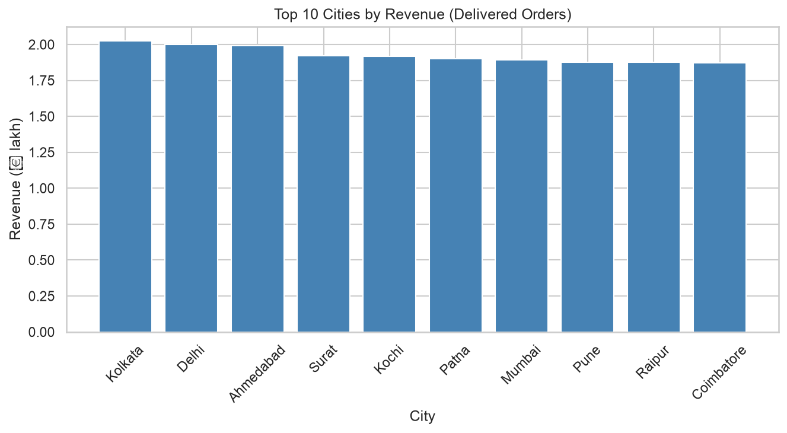
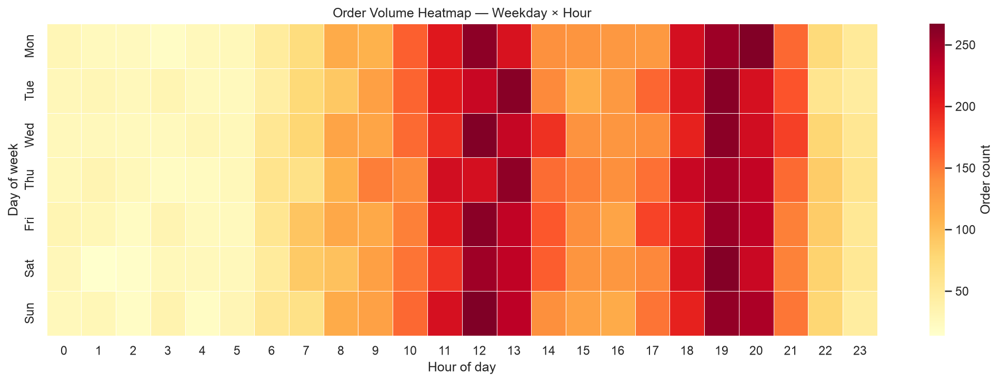
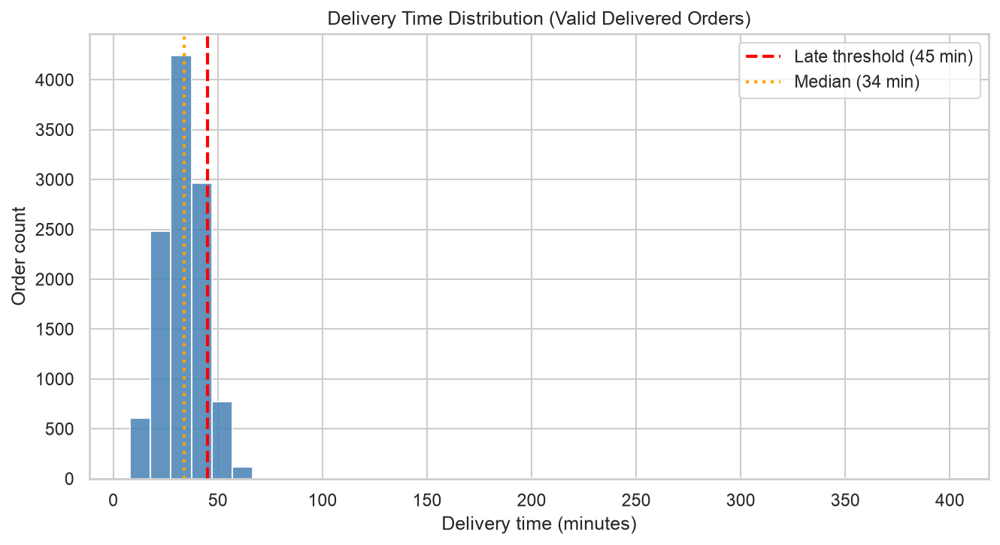
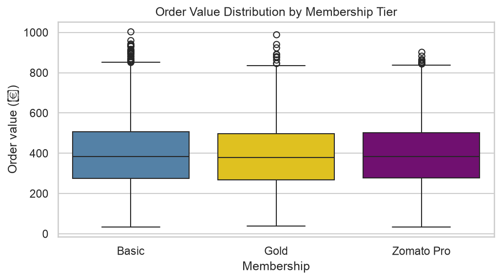
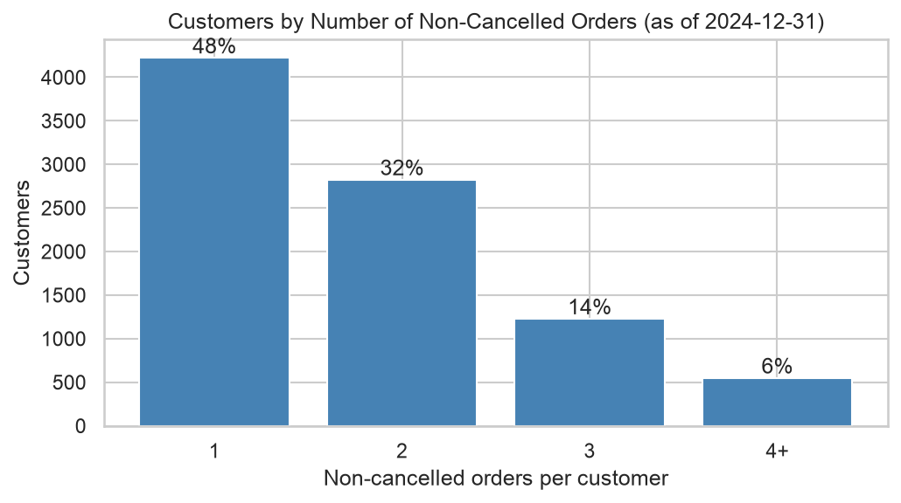
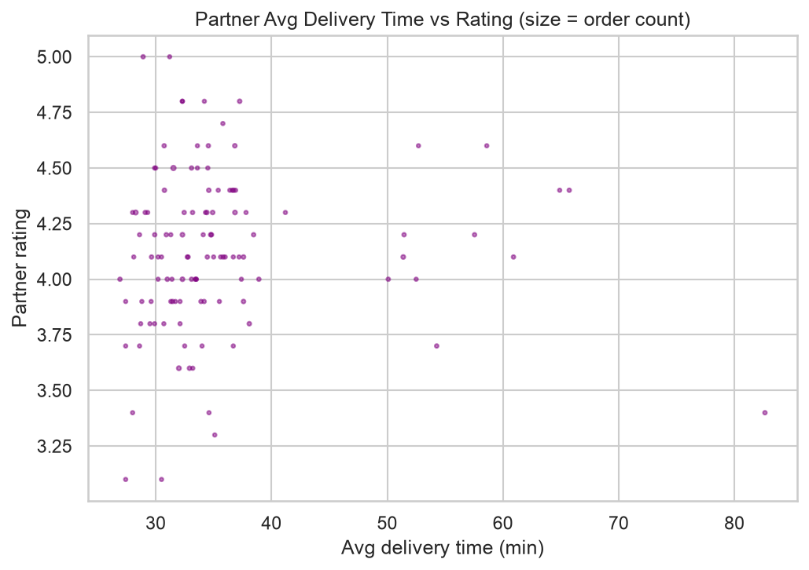
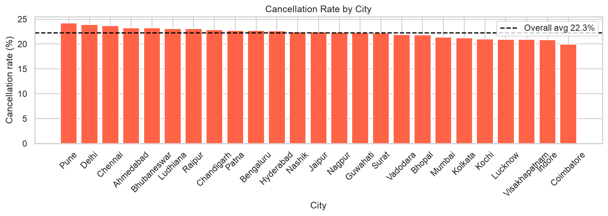
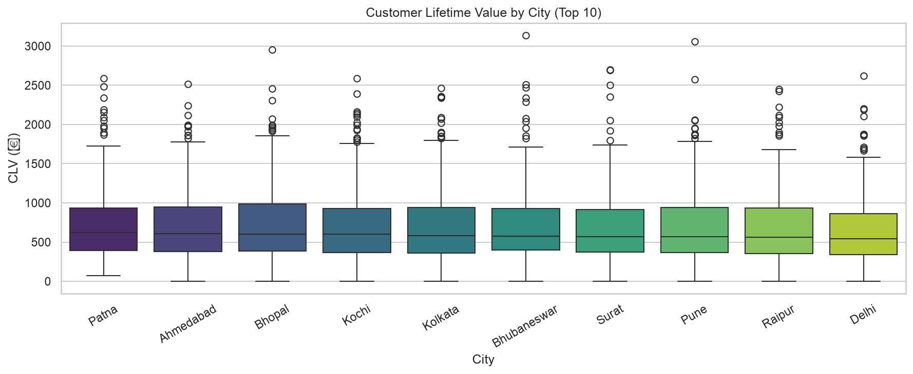

# EDA Report: Zomato Business Intelligence

Week 3, Steps 3-5. Generated by src/eda_takeaways.py; all numbers are computed.

## 1. Data and method

- Data: 12 cleaned tables, 2023-01-01 to 2024-12-31, analysed through data/cleaned/analytical_base_table.csv (20,475 orders, one row per order).
- Subsets: all orders (20,475) for status, payment and cancellation questions; delivered orders (11,390) for revenue and basket size; valid deliveries (11,273, delivery time > 0) for delivery-time questions.
- Definitions (documentation/kpi_definitions.md): revenue = final_amount of delivered orders; late = delivery over 45 minutes; an order's city and cuisine come from its restaurant. A customer's city and cuisine (Q8) come from the restaurant of their first order.
- Method: every takeaway below is computed from the data. Group differences are tested with Kruskal-Wallis (delivery times, order values, ratings, CLV) or chi-square (rates). Many tests are run, so isolated p-values just under 0.05 should be read with caution.
- Charts: 38 in total (18 Matplotlib, 20 Seaborn), listed in documentation/eda_chart_register.csv.
- SQL cross-checks against the Week 1 database: Top revenue city: SQL Kolkata ₹202,300.15 / Python Kolkata ₹202,300.15 (match); Peak order hour: SQL 19 / Python 19 (match); Top cuisine by revenue: SQL South Indian / Python South Indian (match)

| Check | SQL | Python | Match |
|---|---|---|---|
| Top revenue city | Kolkata ₹202,300.15 | Kolkata ₹202,300.15 | ✅ |
| Peak order hour | 19 | 19 | ✅ |
| Top cuisine by revenue | South Indian | South Indian | ✅ |

## 2. Findings by business question

### Q1. Which restaurants and cuisines generate the most revenue, and how has it changed over time?

- **m01_revenue_by_city**: Kolkata leads with ₹2.02 lakh of delivered revenue; the top 3 cities hold 14% of the total and the largest city earns 1.57x the smallest (Nagpur)
- **m02_revenue_by_cuisine**: South Indian is the top cuisine at ₹3.07 lakh, 34% more than #10 Seafood
- **m03_monthly_revenue**: Monthly revenue ranges ₹1.60 lakh-₹2.06 lakh (variation 5%); the last 6 months average +1.6% vs the first 6 and 2024 is +0.4% vs 2023, so there is no clear trend
- **m10_stacked_cuisine_city**: In the top 6 cities the overall top-5 cuisines make up 20%-35% of revenue, and the #1 cuisine differs by city (5 different leaders across 6 cities)
- **m11_cumulative_revenue**: Cumulative delivered revenue reaches ₹44.06 lakh over 24 months, about ₹1.84 lakh per month; 0.0% of delivered orders have no parseable date and are excluded from all time-based charts

### Q2. What are the peak ordering hours, and how do weekday and weekend differ?

- **m05_orders_by_hour**: Peak hour is 19:00 on weekdays and 19:00 on weekends; 19:00-22:00 carries 22.2% of orders vs 12.5% if orders were spread evenly over 24 hours
- **s12_heatmap_weekday_hour**: Busiest slot is Sun 12:00 (267 orders); quietest is Sat 1:00 (14 orders)

### Q3. How are delivery times distributed, and how do they vary by city, traffic and weather?

- **m07_delivery_time_hist**: Median delivery is 34 min and 90% arrive within 47 min; 12.1% exceed the 45-min late threshold
- **m04_monthly_delivery_time**: Monthly average delivery time stays between 33.5 and 37.4 min; the fitted trend moves it -0.5 min over 24 months, i.e. no trend
- **m13_delivery_vs_partner_avg**: A partner's historical average delivery time and this order's delivery time correlate at r=+0.004 (effectively none), so past partner speed does not predict this delivery
- **s05_delivery_by_city**: Median delivery across the top 8 cities ranges 33-34 min; differences are not statistically significant (p=1.00)
- **s13_delivery_by_weather**: Mean delivery by weather runs from 34.8 min (Cloudy) to 36.4 min (Foggy), a 1.6-min spread; differences are not statistically significant (p=0.61)
- **s14_delivery_by_traffic**: Only 572 of 11,273 valid deliveries matched a traffic record; median delivery Low→Severe is 36 / 35 / 34 / 34 min; differences are not statistically significant (p=0.17)
- **s10_delivery_kde**: Delivery times are right-skewed (skew 9.64): median 34 min, mean 35.4 min, longest 399 min
- **s08_regplot_preptime**: Each extra minute of average prep time goes with +0.05 min of delivery (r=+0.013, effectively none); prep time explains 0.02% of the variation
- **s01_correlation_heatmap**: The strongest correlation with delivery time is traffic_score (r=-0.029); every other feature is weaker. food_cost and final_amount correlate at r=0.92 because the bill is built from the food cost
- **m16_late_delivery_by_city**: Late-delivery rate ranges from 9.4% (Chandigarh) to 13.9% (Patna); differences are not statistically significant (p=0.96)
- **s18_late_by_hour**: Late rate by hour ranges 9.0%-14.3% and differences are not statistically significant (p=0.52); peak hours 12.3% vs off-peak 12.1%
- **s09_delivery_vs_traffic**: Across 572 deliveries with a traffic match, traffic score and delivery time correlate at r=-0.029 (effectively none)

### Q4. What is the average basket size, and how does it differ by membership tier?

- **m06_order_value_hist**: Median delivered order value is ₹383; the middle half of orders falls between ₹275 and ₹504
- **m14_basket_by_membership**: Average order value: Basic ₹395, Gold ₹389, Zomato Pro ₹391; differences are not statistically significant (p=0.32)
- **s07_basket_by_membership**: Median order value: Basic ₹385, Gold ₹379, Zomato Pro ₹383; differences are not statistically significant (p=0.32)
- **s11_food_cost_kde**: Median food cost is ₹382 (skew 0.13); food cost is a median 91% of the final bill

### Q5. What share of customers are repeat vs one-time?

- **m17_orders_per_customer**: 47.9% of customers have exactly 1 non-cancelled order and 52.1% have 2 or more (mean 1.80)
- **s19_repeat_by_membership**: Repeat-customer share by membership: Basic 52.4%, Gold 51.7%, Zomato Pro 51.8%; differences are not statistically significant (p=0.81)

### Q6. Which delivery partners are consistently the fastest and best rated?

- **m12_delivery_by_vehicle**: Median delivery by vehicle: Bicycle 33 min, Car 33 min, Bike 34 min, Scooter 34 min; differences are not statistically significant (p=0.40)
- **m12b_partner_speed_vs_rating**: Among 112 partners with 10+ deliveries, average delivery time and rating correlate at r=+0.04 (effectively none); partner averages range 26.9-82.6 min, which with about 10 orders each is mostly sampling noise

### Q7. What patterns lie behind cancellations?

- **s03_order_status_count**: Order status split: Delivered 55.6%, Cancelled 22.3%, Food Not Delivered 11.5%, Delivered Late 10.5%
- **m09_order_status_pie**: 66.1% of orders reach the customer (Delivered or Delivered Late); 33.9% are cancelled or not delivered
- **s04_payment_method**: Most-used method is Debit Card (17.3%) and least-used is Upi (16.3%)
- **m08_payment_pie**: The 6 payment methods each hold 16.3%-17.3% of orders, a near-even split
- **m15_cancel_by_city**: Cancellation rate ranges from 20.0% (Coimbatore) to 24.3% (Pune) across cities; differences are not statistically significant (p=0.95)
- **s15_cancel_by_payment**: Highest cancellation is Net Banking (23.8%), lowest Cash On Delivery (20.9%); differences are statistically significant (p=0.034)
- **s02_pairplot**: Delivery time's largest |r| with the other pairplot features is 0.015 (food_cost), so no relationships are visible
- **s15b_cancel_by_mem_hour**: Cancellation by membership is Basic 22.1%, Gold 22.9%, Zomato Pro 22.4%, not statistically significant (p=0.60); by hour it ranges 19.6%-26.9%, not statistically significant (p=0.84)
- **s06_rating_by_cuisine**: Median restaurant rating across the top 6 cuisines ranges 3.80-4.00; differences are not statistically significant (p=0.16)

### Q8. How does customer lifetime value distribute across cities and cuisines?

- **s16_clv_by_city**: Median CLV across the top 10 customer cities ranges ₹548-₹642; differences are not statistically significant (p=0.44)
- **s17_clv_by_cuisine**: Median CLV across the top 6 cuisines ranges ₹551-₹593; differences are not statistically significant (p=0.51)

## 3. Data-quality notes

- Traffic data matched only 5.1% of valid deliveries (city + date + hour join), so traffic findings rest on a small sample.
- Weather data matched 62.5% of valid deliveries.
- 6,832 orders are dated before the customer's registration date; they are flagged (tenure_is_negative), not dropped.
- There is no cancellation-reason column, so Q7 describes patterns, not causes.
- Dates: raw dates written with '/' mix DD/MM and MM/DD. The parsers read a part above 12 as the day; 3,222 orders have both parts at 12 or under and are read as MM/DD, so their day and month may be swapped. 0.0% of orders still have no parseable date.
- Distance proxy: restaurants sit a median 947 km (90th percentile 1422 km) from the centre of their own city, so the restaurant coordinates do not match their cities and distance_to_city_centre_km carries no real distance information; it is excluded from the delivery model. customers.csv has no coordinates at all.

## 4. What this means for modelling

- Delivery time: the largest |r| between delivery time and any numeric model feature is 0.092 (traffic_score), and the group tests above find almost no differences. The regression model scores R²=-0.002 and RMSE=9.8 min on the test set, no better than predicting the mean.
- Churn: 87.4% of customers churn in the 60-day window; the classifier's test ROC-AUC is 0.52 (0.50 = random).
- Conclusion: this dataset shows no learnable signal for either target. That is a property of the data, not a coding error. The pipelines are reusable on data that does contain signal.
